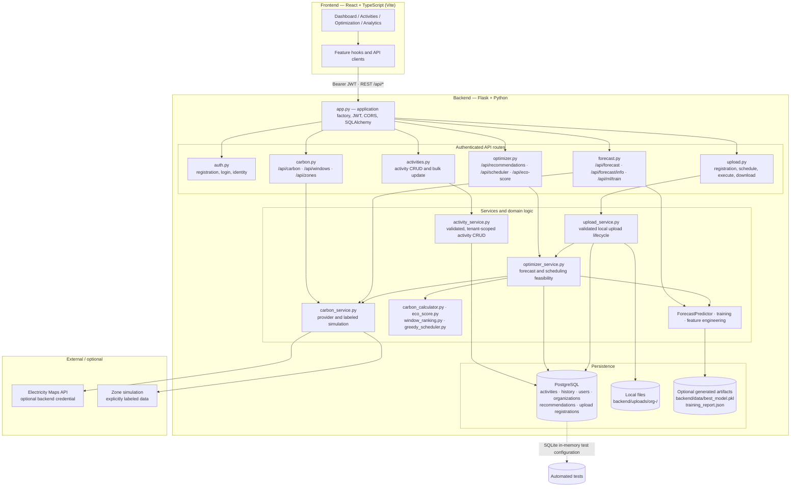

# Diagram 1 — Overall System Architecture

**Description:** High-level view of the React/TypeScript frontend and Flask API,
the PostgreSQL application database (SQLite is used by tests), carbon-data
providers/fallback, forecast code, and organization-scoped local upload storage.

**Recommended placement:** BE Report — Section 1 (Introduction/Overview); IEEE Paper — Figure 1.

Only the file-upload lifecycle has a supported executor: after explicit user
action, the backend finalizes validated content in local organization-scoped
storage. Other activity categories produce estimates and recommendations; no
general workload runner or automatic scheduling worker is present.
