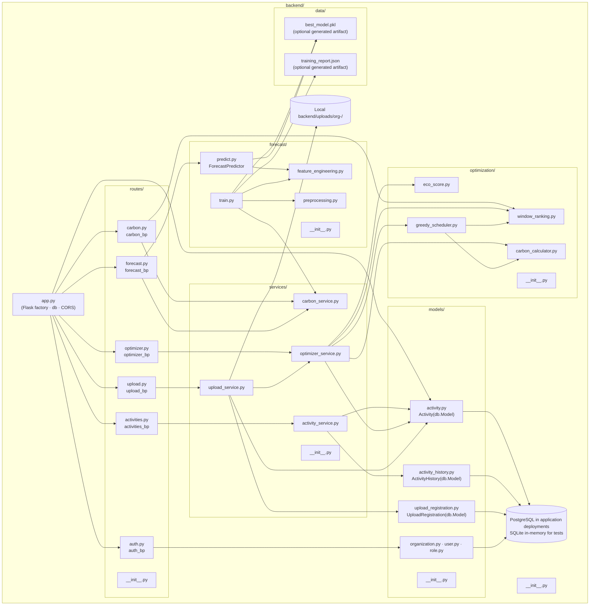

# Diagram 2 — Component Diagram

**Description:** Shows the backend package areas used by the authenticated API,
the activity and upload services, and shared forecasting/optimization modules.

**Recommended placement:** BE Report — Section 3 (System Design); IEEE Paper — Figure 2.

Startup uses SQLAlchemy `create_all()` plus a PostgreSQL-specific additive
schema helper. This is not a versioned migration framework; legacy ownership
data is not guessed. Automated tests use SQLite fixtures.
