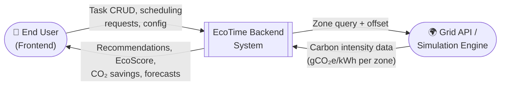
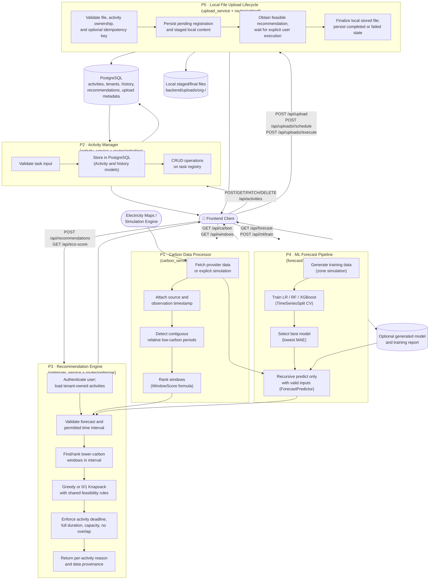

# Diagram 3 — Data Flow Diagram (Level 0 & Level 1)

**Description:** Level 0 (context) shows the system receiving authenticated user
requests and optional external grid data. Level 1 follows the implemented
carbon, activity, recommendation, forecast, and upload flows.

**Recommended placement:** BE Report — Section 4 (Data Design); IEEE Paper — Figure 3.

---

## Level 0 — Context DFD

---

## Level 1 — DFD

The recommendation endpoint loads activity metrics and scheduling bounds from
the authenticated user's organization. Carbon API readings and forecasts carry
source/timestamp metadata; simulated values are labeled as simulation. Invalid
or unavailable forecasts do not produce scheduling recommendations. A forecast
range with no lower-carbon band yields no Green Windows. General activity
recommendations do not execute workloads. Only the upload flow finalizes local
file content after an explicit execution request; uploads are not sent to a
remote cloud or compute service.
